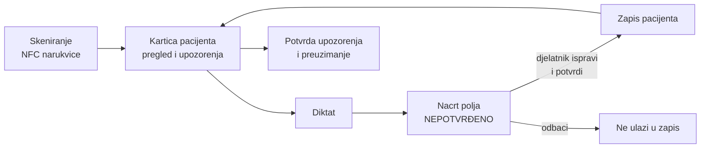

# Primopredaja smjene uz NFC narukvicu i glasovni unos

**Idejno rješenje za AI2MED hackathon, izazov 12: poboljšanje prijenosa informacija između zdravstvenih djelatnika.**

Djelatnik uz krevet prisloni mobitel na narukvicu pacijenta i u nekoliko sekundi vidi sve što treba znati za preuzimanje smjene. Novo stanje pacijenta izgovori, a sustav ga pretvori u strukturirani zapis koji djelatnik pregleda i potvrdi.

> **Napomena:** svi podaci o pacijentima i djelatnicima u prototipu su izmišljeni. Prototip nije medicinski proizvod i nije namijenjen radu sa stvarnim podacima.

---

## Problem

Primopredaja smjene jedan je od najrizičnijih trenutaka u skrbi za pacijenta. Informacije se prenose usmeno ili na papiru, u žurbi, pred kraj smjene. Najlakše se izgubi upravo ono što se dogodilo zadnje:

- nalaz koji je stigao, a nitko ga nije pogledao,
- lijek uveden poslijepodne, o kojem nitko nije napisao bilješku,
- pad tlaka ili pulsa u zadnjem mjerenju,
- zadatak kojem je prošao rok.

Istodobno, upisivanje podataka oduzima vrijeme koje djelatnik ne provodi uz pacijenta, pa se zapisi pišu naknadno, skraćeno ili nikako.

## Rješenje

Rješenje se sastoji od dvije povezane funkcionalnosti.

### 1. NFC narukvica: pravi podaci o pravom pacijentu, odmah

Svaki pacijent nosi narukvicu s NFC oznakom. Na njoj je samo anonimni ID, bez imena i medicinskih podataka. Skeniranjem uz krevet djelatnik potvrđuje identitet pacijenta i otvara karticu pripremljenu za primopredaju:

- **pregled za primopredaju:** zadnji vitalni znakovi s promjenom od početka smjene, zadnji nalazi, aktualna terapija, zadnje bilješke i otvoreni zadaci,
- **upozorenja koja se ne smiju propustiti:** nepregledan nalaz, nespomenuta promjena terapije, pogoršanje vitalnih znakova, zadatak koji kasni,
- **struktura I-PASS:** težina stanja, sažetak, akcijska lista, plan za moguće situacije, provjera i preuzimanje,
- **zapisnik pristupa:** tko je, kada i kako (skeniranjem ili ručno) pristupio zapisu, uključujući odbijene pokušaje.

Pacijenta se ne može preuzeti dok djelatnik ne potvrdi sva upozorenja.

### 2. Glasovni unos: govori, pregledaj, potvrdi

Djelatnik pritisne **Diktiraj** i govori, npr.:

> *„Tlak 100 na 60, puls 52. Spironolakton ukinut. Zadatak: kontrola kalija u 22 sata. Bolesnik pospan, budi se na poziv.“*

Sustav izgovoreno razvrsta u polja zapisa:

| Polje | Iz diktata |
|---|---|
| Vitalni znakovi | RR 100/60 mmHg, FP 52/min |
| Terapija | Spironolakton, ukinut |
| Zadatak | Kontrola kalija, rok 22:00 |
| Opća bilješka | Bolesnik pospan, budi se na poziv. |

Svako polje je **nacrt označen kao nepotvrđen**. Djelatnik ga pregleda, po potrebi ispravi i potvrdi ili odbaci. **Ništa ne ulazi u zapis bez potvrde čovjeka.**

## Kako izgleda tok uz krevet



Potvrđeni podaci odmah sudjeluju u pregledu i upozorenjima. Na primjer, izgovoreni i potvrđeni puls od 128/min odmah daje kritično upozorenje, a pacijent se na popisu odjela označava crveno, među pacijentima kojima treba hitna pozornost.

## Načela dizajna

**Čovjek odlučuje.** Automatski popunjena polja su samo prijedlog. U zapis ulazi tek ono što djelatnik pregleda i potvrdi, a zapisnik bilježi tko je potvrdio, ispravio ili odbacio podatak.

**Ništa se ne izmišlja.** Ono što se ne može pouzdano svrstati ostaje u općoj bilješci, uz objašnjenje:
- vrijednost izvan uvjerljivog raspona („tlak 300 na 80“),
- dvosmislena fraza („frekvencija 88“: srčana ili disanja?),
- isti podatak izgovoren dvaput s različitim vrijednostima,
- ukidanje lijeka koji pacijent nema u terapiji.

**Pravila, a ne AI, za ono što je kritično.** Upozorenja i razvrstavanje diktata rade po jasnim pravilima: predvidljivi su, provjerljivi i rade bez poslužitelja. AI se koristi samo za neobavezni tekstualni sažetak, koji mora navesti izvorne zapise, a sažetak bez njih se odbacuje.

**Sljedivost.** Uz svaki podatak na kartici stoji gumb *izvor* koji otvara izvorni zapis. Uz svako polje iz diktata vidi se doslovni dio izgovorenog teksta iz kojeg je nastalo.

**Privatnost.** Na narukvici je samo anonimni ID. Djelatnik vidi samo pacijente svog odjela, a pokušaj pristupa pacijentu s drugog odjela odbija se i bilježi.

## Isprobajte prototip

Prototip je web aplikacija koja radi u pregledniku, bez instalacije paketa.

```bash
cd "files (1)/primopredaja-nfc/primopredaja-nfc"
python -m http.server 8000      # na Windowsu po potrebi: py -m http.server 8000
```

Otvorite http://localhost:8000 u **Chromeu ili Edgeu** i prijavite se demo PIN-om:

| PIN | Djelatnik | Odjel |
|---|---|---|
| 2222 | dr. Luka Radić, dežurni liječnik | Interna klinika, odjel B |
| 3333 | Ivana Tomić, medicinska sestra | Interna klinika, odjel B |
| 4444 | dr. Marko Grgić, kirurg | Kirurgija A (za prikaz odbijenog pristupa) |

**Bez NFC čitača i mikrofona** demo radi u cijelosti:
- **Skeniraj narukvicu** nudi odabir demo narukvice (označeno kao simulirano skeniranje),
- uz glasovni unos su gotovi **primjeri diktata**, a tekst se može i upisati.

Pravo NFC skeniranje radi u Chromeu na Androidu preko HTTPS-a (npr. GitHub Pages). Upute za NFC narukvice, AI sažetak, testove i scenarij za prezentaciju korak po korak su u [dokumentaciji aplikacije](files%20(1)/primopredaja-nfc/primopredaja-nfc/README.md).

## Tehnologija

| Dio | Rješenje |
|---|---|
| Aplikacija | HTML, CSS i JavaScript, bez frameworka i build koraka; radi na mobitelu i računalu, sa svijetlim i tamnim načinom za noćnu smjenu |
| NFC | Web NFC API (Chrome na Androidu); na iPhoneu narukvica otvara poveznicu |
| Govor u tekst | Web Speech API preglednika, hrvatski jezik |
| Razvrstavanje diktata i upozorenja | vlastita pravila u JavaScriptu, pokrivena automatskim testovima |
| AI sažetak (neobavezno) | Claude API preko lokalnog Node.js poslužitelja; ključ ostaje na poslužitelju |

## Od prototipa do stvarne upotrebe

Prototip pokazuje ideju i tok rada. Za primjenu u bolnici bilo bi potrebno:

1. **Integracija s bolničkim informacijskim sustavom:** podaci o pacijentima i potvrđeni unosi čitaju se iz njega i zapisuju u njega, umjesto u preglednik.
2. **Prepoznavanje govora unutar bolničke infrastrukture:** u prototipu preglednik šalje zvuk vanjskoj usluzi, što je prihvatljivo samo za izmišljene podatke.
3. **Prijava službenom karticom ili bolničkim računom** umjesto PIN-a, i zapisnik pristupa na poslužitelju koji se ne može mijenjati.
4. **Klinička validacija** pravila za upozorenja i razvrstavanje diktata s liječnicima i medicinskim sestrama, uz proširenje medicinskog rječnika.
5. **Usklađenost s GDPR-om** i propisima o medicinskim proizvodima.

---

AI2MED hackathon, studeni 2026.
